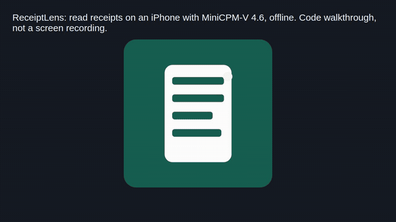

# ReceiptLens



*The GIF is a walkthrough of the code, not a screen recording of the app.*

An iPhone app that reads receipts, documents and screenshots offline with MiniCPM-V 4.6.

```bash
git clone https://github.com/jayhemnani9910/receiptlens-minicpm-v46.git && cd receiptlens-minicpm-v46 && xcodegen generate && open ReceiptLens.xcodeproj
```

[](https://github.com/jayhemnani9910/receiptlens-minicpm-v46/actions/workflows/ci.yml)

You need a Mac with Xcode and XcodeGen (`brew install xcodegen`), and an iPhone on iOS 16.4 or later.

## Use

1. In Xcode, pick your team under Signing & Capabilities and your iPhone as the run destination. Run it.
2. Open the Model tab and download the two model files (about 1.6 GB). Keep the app open until it finishes.
3. On the Scan tab, pick a mode: Receipt, Document or Screen.
4. Take a photo or pick one from your library, then tap Analyze. The answer streams in as the model writes it. Tap Stop to cut it short.
5. Type your own prompt to replace the built-in one for that mode.

Every scan is saved with its image, prompt and output. The History tab lists them. Swipe to delete.

## How it works

The model runs on the phone through llama.cpp's `mtmd` library, with Metal on the GPU. The app ships a prebuilt `llama.xcframework` in `Vendor/` and talks to it through a small C bridge in `ReceiptLens/NativeBridge/Bridge/MBMtmd.mm`.

For each scan, the image is scaled so its longest side is at most 1600 px and saved as a JPEG. The bridge puts the image and the prompt into one chat-format user turn, runs a single prefill, and samples up to 768 tokens at temperature 0.2. Each scan starts with an empty KV cache.

The receipt prompt asks for merchant, date, line items, prices, tax, tip, discounts, total, payment method, and any mismatch in the math. It tells the model to write "unclear" rather than guess. All three prompts are in `ReceiptLens/Services/PromptTemplate.swift`.

## Model files

Downloaded once from [openbmb/MiniCPM-V-4.6-gguf](https://huggingface.co/openbmb/MiniCPM-V-4.6-gguf) into the app's Documents folder:

| File | Size | What |
| --- | --- | --- |
| `MiniCPM-V-4_6-Q4_K_M.gguf` | 529 MB | language model, 4-bit |
| `mmproj-model-f16.gguf` | 1.1 GB | vision projector, saved as `MiniCPM-V-4_6-mmproj-master-f16.gguf` |

After that the app makes no network calls. Scans and images stay in the app sandbox until you delete them or the app.

## Build without a Mac

The `Build unsigned iOS IPA` workflow builds an unsigned IPA on a GitHub Actions macOS runner. You can then sign and install it from Linux.

1. Fork this repo and run the `Build unsigned iOS IPA` workflow from the Actions tab.
2. Download the `ReceiptLens-unsigned-ipa` artifact.
3. On Linux, install iLoader and `usbmuxd`.
4. Use iLoader or SideStore with your Apple ID to sign and install the IPA.

Apps sideloaded with a free Apple ID need to be refreshed from time to time. This path is for personal testing, not the App Store or TestFlight. On a private fork, macOS runner minutes count against your free quota.

## Tests

CI builds the app for device and runs the unit tests in `ReceiptLensTests/` on the iOS simulator. To run them locally:

```bash
xcodegen generate
xcodebuild -project ReceiptLens.xcodeproj -scheme ReceiptLens -destination 'platform=iOS Simulator,name=iPhone 16' test
```

See [CONTRIBUTING.md](CONTRIBUTING.md) to help out.

## Credits and license

The native bridge started from the iOS demo in [OpenBMB/MiniCPM-V-Apps](https://github.com/OpenBMB/MiniCPM-V-Apps). Inference is [llama.cpp](https://github.com/ggml-org/llama.cpp). The model is [MiniCPM-V 4.6](https://huggingface.co/openbmb/MiniCPM-V-4.6-gguf) by OpenBMB, under its own terms.

MIT. See [LICENSE](LICENSE) and [THIRD_PARTY_NOTICES.md](THIRD_PARTY_NOTICES.md).
